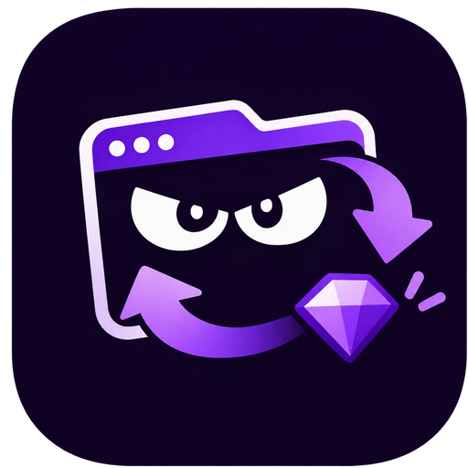

<p align="center">
  
</p>

<h1 align="center">Lurker Drops</h1>

<p align="center">Mantén tus pestañas de Twitch viendo un directo compatible, de forma automática.</p>

<p align="center">
  <a href="https://chromewebstore.google.com/detail/lurker-drops/ebcahoihcbkbebpebmdmofpfohnfinoc"></a>
  <a href="https://diogobruni.github.io/lurker-drops/es/"></a>
  <a href="https://github.com/diogobruni/lurker-drops/releases"></a>
  
</p>

<p align="center">
  <a href="README.md">English</a> ·
  <a href="README.pt-BR.md">Português (Brasil)</a> ·
  Español
</p>

## Qué hace

Lurker Drops es una extensión gratuita para Chrome que mantiene pestañas seleccionadas en un directo de Twitch compatible con tus reglas. Comprueba cada minuto, cambia cuando aparece un directo mejor y se queda callada en segundo plano.

- **Panel de pestañas en lurker** con el título, la vista previa del directo y acciones por pestaña: ir a la pestaña, silenciar, activar/desactivar, editar y cerrar.
- **Ajustes** con categoría de Twitch, filtro de título sin distinguir mayúsculas, favoritos en orden y lista de bloqueo.
- **Selección automática de directo**: primero los favoritos, después el directo elegible con más espectadores. Desactiva Perseguir para seguir los favoritos en orden.
- **Silencio por pestaña** usando el silencio de la pestaña del navegador, sin afectar llamadas ni música.
- **Vigía del chat**: reconecta el chat de Twitch cuando se cae y recarga la página como último recurso, como máximo una vez cada cinco minutos.
- **Cofres de bono**: hace clic en el cofre de Twitch cuando aparece.
- **Capa del modo lurker** en la página de Twitch, con botón Desactivar y aviso antes de navegar fuera.
- **Gestor en ventana aparte** que sigue la última pestaña normal enfocada.
- **Insignia en la barra de herramientas** que muestra cuántos lurkers están activos.
- **Ajustes solo locales** en `chrome.storage.local`, validados con Zod.

## Instalación

### Chrome Web Store (recomendado)

[Instala Lurker Drops desde Chrome Web Store.](https://chromewebstore.google.com/detail/lurker-drops/ebcahoihcbkbebpebmdmofpfohnfinoc)

Funciona en Chrome, Edge, Opera, Brave y otros navegadores Chromium de escritorio.

### Instalación manual desde GitHub

1. Descarga el ZIP de la última versión: [lurker-drops.zip](https://github.com/diogobruni/lurker-drops/releases/latest/download/lurker-drops.zip).
2. Abre `chrome://extensions` (o `edge://extensions` en Edge) y activa el **Modo de desarrollador**.
3. Arrastra el ZIP a la página de extensiones y confirma. No hace falta descomprimir.
4. Fija Lurker Drops, abre el popup, añade tu primer lurker y pulsa **Activar**.

### Desde el código

```bash
pnpm install
pnpm test
pnpm run build
```

Carga la carpeta `dist` generada con **Cargar descomprimida** en la página de extensiones.

## Cómo funciona

1. Elige una categoría, un filtro de título, favoritos o una lista de bloqueo en un ajuste.
2. Asigna ese ajuste a una pestaña y pulsa **Activar**.
3. Cada minuto el worker recoge los directos elegibles, prioriza tus favoritos y mueve la pestaña al ganador.
4. **Perseguir** activado hace ganar al directo con más espectadores; desactivado mantiene los favoritos en tu orden.

El listado público de directos de Twitch devuelve hasta 30 entradas por categoría, así que la búsqueda usa ese top 30. Los favoritos se comprueban directamente y no dependen de ese límite.

## Idiomas

La interfaz y el manifest siguen el idioma del navegador automáticamente, con inglés como reserva:

`en`, `es`, `fr`, `de`, `it`, `pt_BR`, `nl`, `pl`, `ru`, `tr`, `ja`, `ko`, `zh_CN`, `zh_TW`.

Portugués (Brasil) y español tienen soporte completo en la app y en el sitio del producto. Este README también está disponible en [English](README.md) y [Português (Brasil)](README.pt-BR.md).

Para añadir un idioma, copia `src/shared/locales/en.ts` y `public/_locales/en/messages.json` y registra el locale en `src/shared/i18n.ts`.

## Estructura del proyecto

```
src/background/   service worker: selección de directo, control de pestañas, alarmas
src/content/      scripts de contenido de Twitch: chat, capa, cofres
src/popup/        popup y ventana del gestor en React 19 + Tailwind
src/shared/       tipos, almacenamiento, filtros, catálogos de i18n
public/           manifest, iconos, mensajes de locale de la extensión
tests/            suite Vitest
site/             sitio del producto en Astro (GitHub Pages)
```

## Desarrollo

```bash
pnpm install
pnpm run typecheck
pnpm test
pnpm run build
```

- Recarga la extensión descomprimida después de cada build.
- El popup depende de las APIs de extensión de Chrome, así que el servidor Vite por sí solo no puede probarlo.
- Genera las variantes de icono con `python scripts/generate-icons.py` (requiere Pillow).

## Privacidad

- Los ajustes se quedan en `chrome.storage.local`; no hay cuenta, token OAuth ni secreto.
- El único permiso de host es `https://gql.twitch.tv/*`, usado para leer el listado público de directos de Twitch.
- Los scripts de contenido en `https://www.twitch.tv/*` observan el estado del WebSocket del chat y la interfaz de la página. El contenido de los mensajes no se lee, guarda ni transmite.
- Ningún dato va a terceros aparte de Twitch.

## Notas

- La API GraphQL pública de Twitch no es oficial y puede cambiar o limitar peticiones.
- La extensión comprueba una vez por minuto, así que los cambios de audiencia o los directos offline pueden tardar hasta un minuto en aplicarse.
- Los drops y las recompensas siguen las reglas de Twitch y de las campañas. Lurker Drops no los garantiza.
- Después de instalar o recargar la extensión, recarga una vez las pestañas de Twitch ya abiertas para cargar los scripts de contenido.

## Enlaces

- [Sitio del producto](https://diogobruni.github.io/lurker-drops/es/)
- [Chrome Web Store](https://chromewebstore.google.com/detail/lurker-drops/ebcahoihcbkbebpebmdmofpfohnfinoc)
- [Releases](https://github.com/diogobruni/lurker-drops/releases)
- [Issues](https://github.com/diogobruni/lurker-drops/issues)
- [Changelog](CHANGELOG.md)

<p align="center"><sub>Sin relación con Twitch ni con Amazon. Twitch es una marca de Twitch Interactive, Inc.</sub></p>
