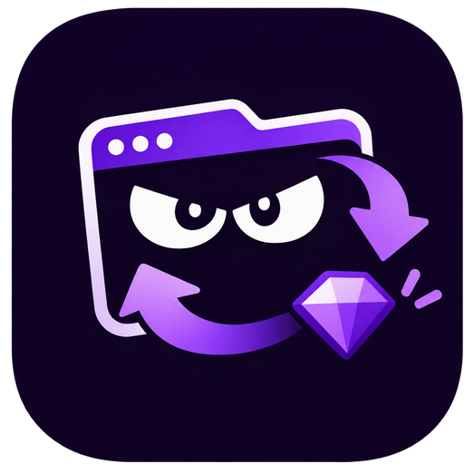

<p align="center">
  
</p>

<h1 align="center">Lurker Drops</h1>

<p align="center">Keep your Twitch tabs watching a matching live, automatically.</p>

<p align="center">
  <a href="https://chromewebstore.google.com/detail/lurker-drops/ebcahoihcbkbebpebmdmofpfohnfinoc"></a>
  <a href="https://diogobruni.github.io/lurker-drops/"></a>
  <a href="https://github.com/diogobruni/lurker-drops/releases"></a>
  
</p>

<p align="center">
  English ·
  <a href="README.pt-BR.md">Português (Brasil)</a> ·
  <a href="README.es.md">Español</a>
</p>

## What it does

Lurker Drops is a free Chrome extension that keeps selected tabs on a Twitch live that matches your rules. It checks every minute, switches when a better live appears, and stays quiet in the background.

- **Lurking tabs dashboard** with the live title, preview, and per-tab actions: go to tab, mute, turn on/off, edit, and close.
- **Presets** with a Twitch category, a case-insensitive title filter, ordered favorites, and a blacklist.
- **Automatic live selection**: favorites first, then the most-watched eligible live. Turn Pursue off to follow favorites in order.
- **Mute per tab** using the browser tab mute, so calls and music keep playing.
- **Chat watchdog**: reconnects Twitch chat when it drops and reloads the page as a last resort, at most once every five minutes.
- **Bonus chests**: clicks the Twitch bonus chest when it appears.
- **Lurker mode overlay** on the Twitch page, with a Turn off button and a guard before you navigate away.
- **Pop-out manager** that follows the last focused normal browser tab.
- **Toolbar badge** showing how many lurkers are active.
- **Local-only settings** in `chrome.storage.local`, validated with Zod.

## Install

### Chrome Web Store (recommended)

[Install Lurker Drops from the Chrome Web Store.](https://chromewebstore.google.com/detail/lurker-drops/ebcahoihcbkbebpebmdmofpfohnfinoc)

Works on desktop Chrome, Edge, Opera, Brave, and other Chromium browsers.

### Manual install from GitHub

1. Download the latest release ZIP: [lurker-drops.zip](https://github.com/diogobruni/lurker-drops/releases/latest/download/lurker-drops.zip).
2. Open `chrome://extensions` (or `edge://extensions` in Edge) and enable **Developer mode**.
3. Drag the ZIP onto the extensions page and confirm. There is no need to unzip.
4. Pin Lurker Drops, open the popup, add your first lurker, and press **On**.

### From source

```bash
cd app
pnpm install
pnpm test
pnpm run build
```

Load the generated `app/dist` folder with **Load unpacked** on the extensions page.

## How it works

1. Pick a category, add a title filter, favorites, or a blacklist in a preset.
2. Assign that preset to a tab and press **On**.
3. Every minute the worker collects eligible lives, prefers your favorites, and moves the tab to the winner.
4. **Pursue** on means most viewers win; **Pursue** off keeps favorites in your order.

Twitch's public stream listing returns up to 30 entries per category, so candidate scanning uses that top 30. Favorites are checked directly and are not limited by it.

## Languages

The interface and manifest follow the browser language automatically, with English as fallback:

`en`, `es`, `fr`, `de`, `it`, `pt_BR`, `nl`, `pl`, `ru`, `tr`, `ja`, `ko`, `zh_CN`, `zh_TW`.

Portuguese (Brazil) and Spanish are fully supported in the app and on the product site. This README is also available in [Português (Brasil)](README.pt-BR.md) and [Español](README.es.md).

To add a language, copy `app/src/shared/locales/en.ts` and `app/public/_locales/en/messages.json`, then register the locale in `app/src/shared/i18n.ts`.

## Project structure

```
app/src/background/   service worker: live selection, tab control, alarms
app/src/content/      Twitch content scripts: chat, overlay, bonus chests
app/src/popup/        React 19 + Tailwind popup and manager window
app/src/shared/       types, storage, filters, i18n catalogs
app/public/           manifest, icons, extension locale messages
app/tests/            Vitest suite
website/              Astro product site (GitHub Pages)
```

## Development

```bash
cd app
pnpm install
pnpm run typecheck
pnpm test
pnpm run build
```

- Reload the unpacked extension after each build.
- The popup depends on Chrome extension APIs, so the Vite dev server alone cannot exercise it.
- Regenerate icon variants with `python app/scripts/generate-icons.py` (requires Pillow).

## Privacy

- Settings stay in `chrome.storage.local`; there is no account, OAuth token, or secret.
- The only host permission is `https://gql.twitch.tv/*`, used to read Twitch's public stream listing.
- Content scripts on `https://www.twitch.tv/*` observe the chat WebSocket state and the page UI. Message contents are not read, stored, or transmitted.
- No data goes to any third party other than Twitch.

## Notes

- Twitch's public web GraphQL API is unofficial and may change or rate-limit requests.
- The extension checks once a minute, so viewership or offline changes can take up to a minute to apply.
- Drops and rewards follow Twitch and campaign rules. Lurker Drops does not guarantee them.
- After installing or reloading the extension, reload open Twitch tabs once so the content scripts are present.

## Links

- [Product site](https://diogobruni.github.io/lurker-drops/)
- [Chrome Web Store](https://chromewebstore.google.com/detail/lurker-drops/ebcahoihcbkbebpebmdmofpfohnfinoc)
- [Releases](https://github.com/diogobruni/lurker-drops/releases)
- [Issues](https://github.com/diogobruni/lurker-drops/issues)
- [Changelog](app/CHANGELOG.md)

<p align="center"><sub>Not affiliated with Twitch or Amazon. Twitch is a trademark of Twitch Interactive, Inc.</sub></p>
