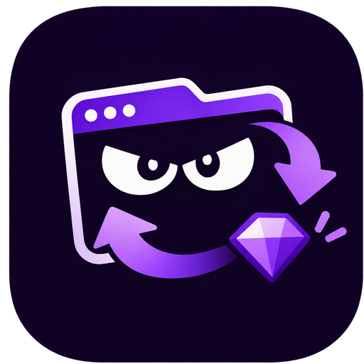

<p align="center">
  
</p>

<h1 align="center">Lurker Drops</h1>

<p align="center">Mantenha suas abas da Twitch assistindo a uma live compatível, automaticamente.</p>

<p align="center">
  <a href="https://chromewebstore.google.com/detail/lurker-drops/ebcahoihcbkbebpebmdmofpfohnfinoc"></a>
  <a href="https://diogobruni.github.io/lurker-drops/pt-br/"></a>
  <a href="https://github.com/diogobruni/lurker-drops/releases"></a>
  
</p>

<p align="center">
  <a href="README.md">English</a> ·
  Português (Brasil) ·
  <a href="README.es.md">Español</a>
</p>

## O que ele faz

Lurker Drops é uma extensão gratuita para Chrome que mantém abas selecionadas em uma live da Twitch compatível com suas regras. Ela confere a cada minuto, troca quando aparece uma live melhor e fica quieta no fundo.

- **Painel de abas em lurker** com título, prévia da live e ações por aba: ir para a aba, mutar, ligar/desligar, editar e fechar.
- **Predefinições** com categoria da Twitch, filtro de título sem diferenciar maiúsculas, favoritos em ordem e lista de bloqueio.
- **Seleção automática de live**: favoritos primeiro, depois a live elegível com mais espectadores. Desligue Perseguir para seguir os favoritos na ordem.
- **Mudo por aba** usando o mudo da aba do navegador, sem afetar chamadas ou música.
- **Vigia do chat**: reconecta o chat da Twitch quando cai e recarrega a página como último recurso, no máximo uma vez a cada cinco minutos.
- **Baús de bônus**: clica no baú da Twitch quando ele aparece.
- **Sobreposição do modo lurker** na página da Twitch, com botão Desligar e aviso antes de navegar para fora.
- **Gerenciador em janela separada** que acompanha a última aba normal em foco.
- **Selo na barra de ferramentas** mostrando quantos lurkers estão ativos.
- **Configurações só locais** em `chrome.storage.local`, validadas com Zod.

## Instalação

### Chrome Web Store (recomendado)

[Instale o Lurker Drops pela Chrome Web Store.](https://chromewebstore.google.com/detail/lurker-drops/ebcahoihcbkbebpebmdmofpfohnfinoc)

Funciona no Chrome, Edge, Opera, Brave e outros navegadores Chromium para desktop.

### Instalação manual pelo GitHub

1. Baixe o ZIP da última versão: [lurker-drops.zip](https://github.com/diogobruni/lurker-drops/releases/latest/download/lurker-drops.zip).
2. Abra `chrome://extensions` (ou `edge://extensions` no Edge) e ative o **Modo desenvolvedor**.
3. Arraste o ZIP para a página de extensões e confirme. Não precisa descompactar.
4. Fixe o Lurker Drops, abra o popup, adicione seu primeiro lurker e aperte **Ligar**.

### A partir do código

```bash
cd app
pnpm install
pnpm test
pnpm run build
```

Carregue a pasta `app/dist` gerada com **Carregar sem compactação** na página de extensões.

## Como funciona

1. Escolha uma categoria, um filtro de título, favoritos ou uma lista de bloqueio em uma predefinição.
2. Atribua a predefinição a uma aba e aperte **Ligar**.
3. A cada minuto o worker coleta as lives elegíveis, prioriza seus favoritos e move a aba para a vencedora.
4. **Perseguir** ligado faz a live com mais espectadores vencer; desligado mantém os favoritos na sua ordem.

A listagem pública de lives da Twitch retorna até 30 entradas por categoria, então a busca usa esse top 30. Favoritos são verificados diretamente e não dependem desse limite.

## Idiomas

A interface e o manifest seguem o idioma do navegador automaticamente, com inglês como reserva:

`en`, `es`, `fr`, `de`, `it`, `pt_BR`, `nl`, `pl`, `ru`, `tr`, `ja`, `ko`, `zh_CN`, `zh_TW`.

Português (Brasil) e espanhol têm suporte completo no app e no site do produto. Este README também está disponível em [English](README.md) e [Español](README.es.md).

Para adicionar um idioma, copie `app/src/shared/locales/en.ts` e `app/public/_locales/en/messages.json` e registre o locale em `app/src/shared/i18n.ts`.

## Estrutura do projeto

```
app/src/background/   service worker: seleção de live, controle de abas, alarmes
app/src/content/      scripts de conteúdo da Twitch: chat, sobreposição, baús
app/src/popup/        popup e janela do gerenciador em React 19 + Tailwind
app/src/shared/       tipos, armazenamento, filtros, catálogos de i18n
app/public/           manifest, ícones, mensagens de locale da extensão
app/tests/            suíte Vitest
website/              site do produto em Astro (GitHub Pages)
```

## Desenvolvimento

```bash
cd app
pnpm install
pnpm run typecheck
pnpm test
pnpm run build
```

- Recarregue a extensão sem compactação após cada build.
- O popup depende das APIs de extensão do Chrome, então o servidor Vite sozinho não consegue testá-lo.
- Gere as variantes de ícone com `python app/scripts/generate-icons.py` (requer Pillow).

## Privacidade

- As configurações ficam em `chrome.storage.local`; não há conta, token OAuth ou segredo.
- A única permissão de host é `https://gql.twitch.tv/*`, usada para ler a listagem pública de lives da Twitch.
- Scripts de conteúdo em `https://www.twitch.tv/*` observam o estado do WebSocket do chat e a interface da página. O conteúdo das mensagens não é lido, armazenado nem transmitido.
- Nenhum dado vai para terceiros além da Twitch.

## Observações

- A API GraphQL pública da Twitch não é oficial e pode mudar ou limitar requisições.
- A extensão confere uma vez por minuto, então mudanças de audiência ou lives offline podem levar até um minuto para aplicar.
- Drops e recompensas seguem as regras da Twitch e das campanhas. O Lurker Drops não os garante.
- Após instalar ou recarregar a extensão, recarregue as abas da Twitch já abertas uma vez para carregar os scripts de conteúdo.

## Links

- [Site do produto](https://diogobruni.github.io/lurker-drops/pt-br/)
- [Chrome Web Store](https://chromewebstore.google.com/detail/lurker-drops/ebcahoihcbkbebpebmdmofpfohnfinoc)
- [Releases](https://github.com/diogobruni/lurker-drops/releases)
- [Issues](https://github.com/diogobruni/lurker-drops/issues)
- [Changelog](CHANGELOG.md)

<p align="center"><sub>Sem vínculo com a Twitch ou a Amazon. Twitch é uma marca da Twitch Interactive, Inc.</sub></p>
